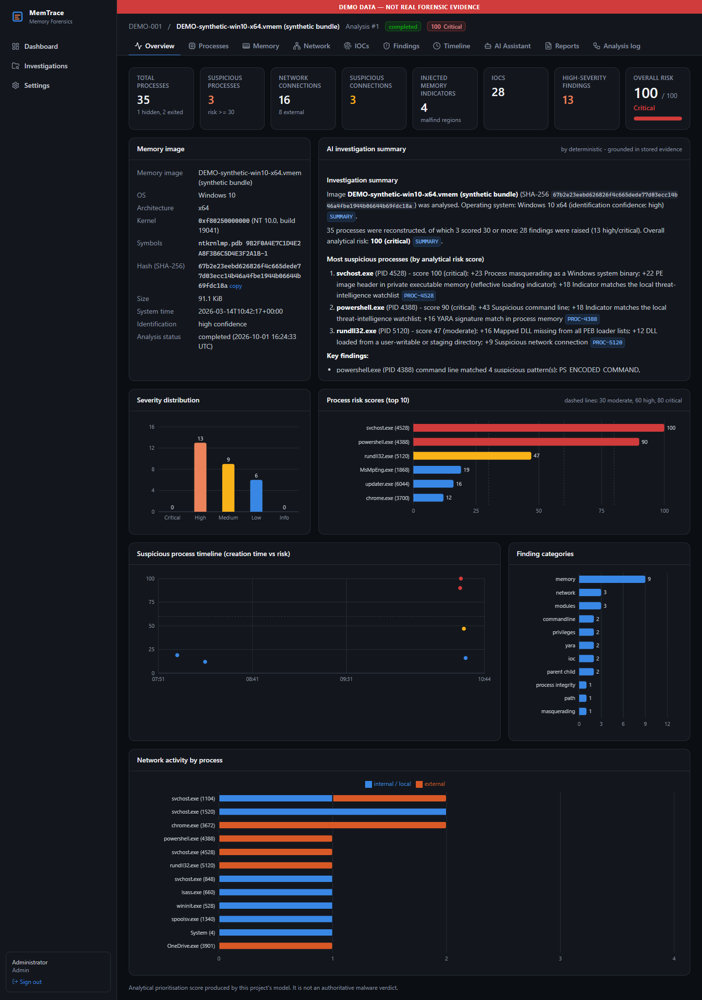
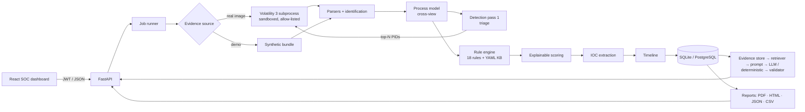
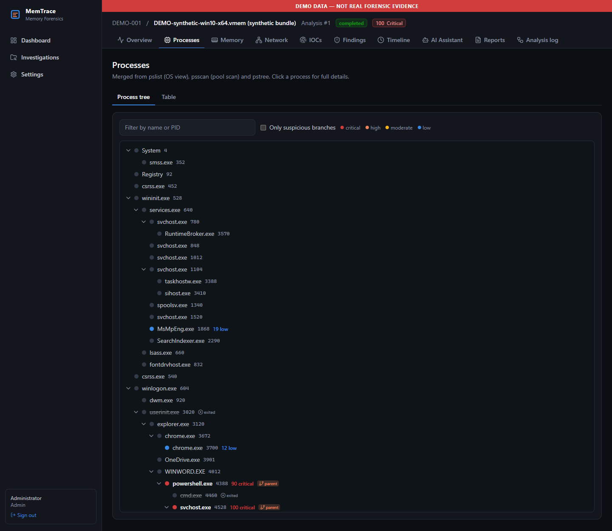
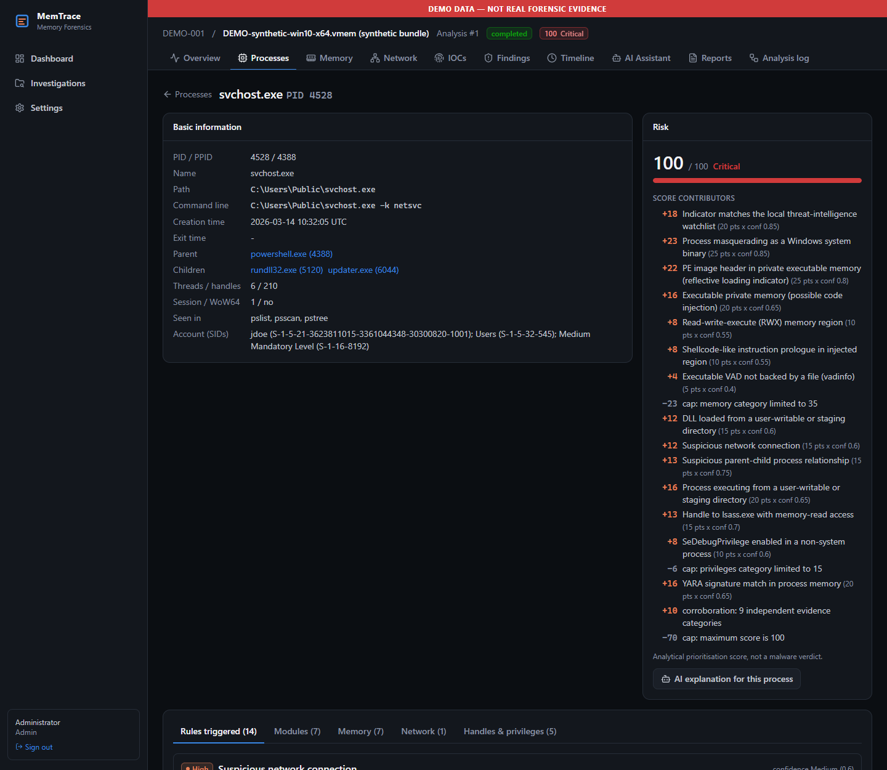
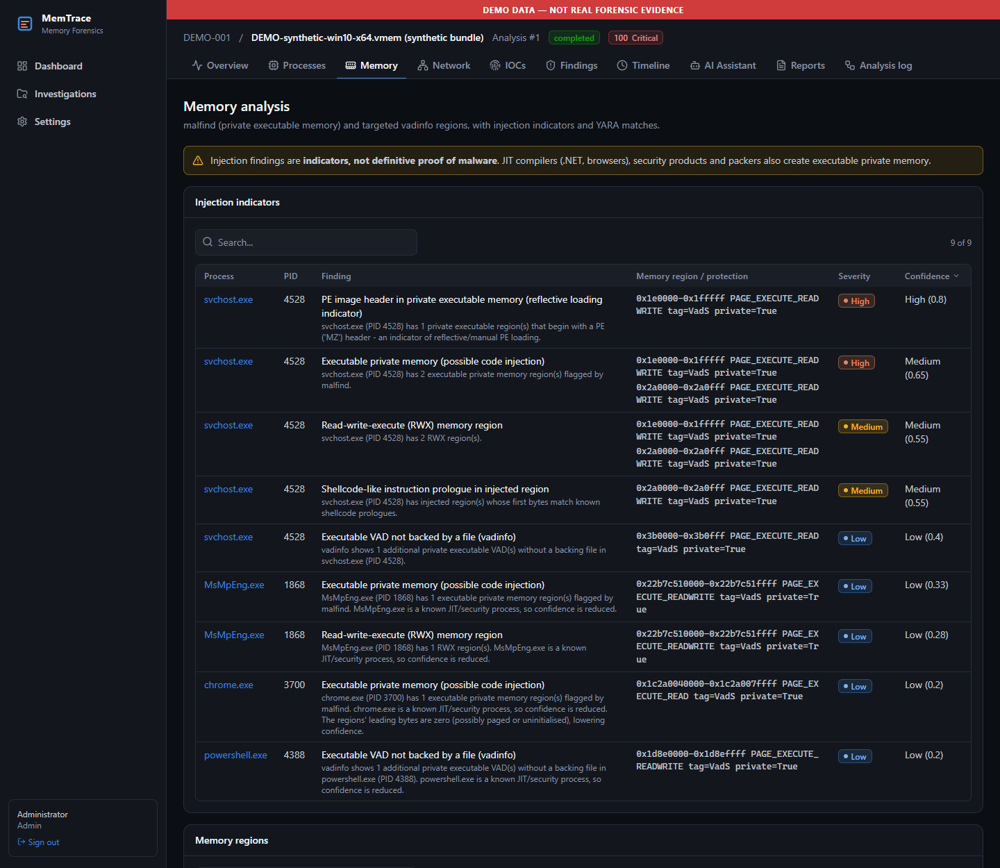
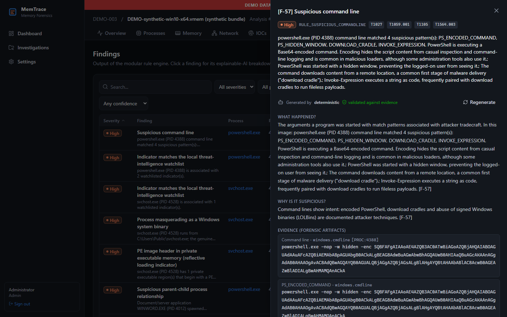
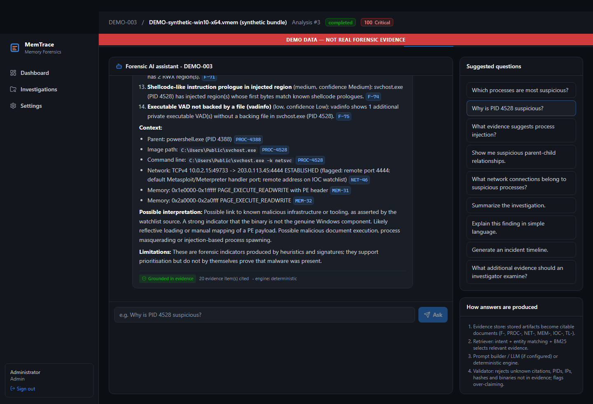
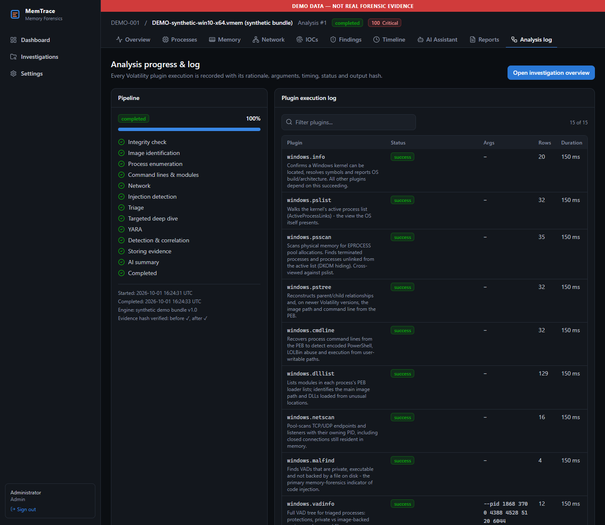
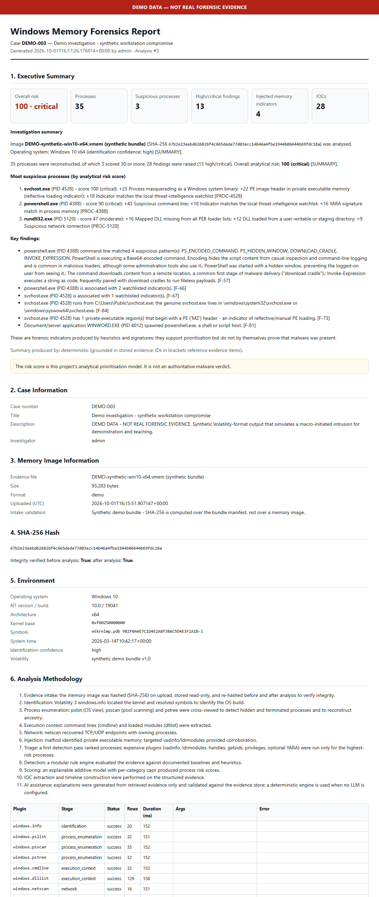

# MemTrace - AI-Assisted Windows Malware Memory Forensics & Analysis System

MemTrace is a defensive digital-forensics platform. It analyses Windows memory images with **Volatility 3**,
extracts structured evidence, runs a **modular rule engine**, computes an **explainable risk score**,
extracts **IOCs**, builds a **timeline**, and gives investigators an **AI assistant that is grounded in the
evidence**. The assistant cites evidence IDs, is checked by a response validator, and works fully offline
through a deterministic engine. It produces hashed **PDF/HTML/JSON/CSV forensic reports** with a chain of custody.

> The core of the project is the forensic engine (**memory forensics → evidence extraction → detection → AI
> correlation**). The dashboard is the presentation layer.



---

## Contents

1. [Features](#features)
2. [Final architecture](#final-architecture)
3. [Technology stack](#technology-stack)
4. [Complete folder structure](#complete-folder-structure)
5. [Setup commands](#setup-commands)
6. [Environment variables](#environment-variables)
7. [Demo instructions](#demo-instructions)
8. [Real memory dump instructions](#real-memory-dump-instructions)
9. [Testing instructions](#testing-instructions)
10. [API documentation](#api-documentation)
11. [Screenshots](#screenshots)
12. [Research and technical contribution](#research-and-technical-contribution)
13. [Project limitations](#project-limitations)
14. [Future improvements](#future-improvements)
15. [Viva questions and answers](#viva-questions-and-answers)
16. [Final-year project presentation flow](#final-year-project-presentation-flow)

Detailed documents: [architecture](docs/architecture.md) · [forensic methodology](docs/forensic-methodology.md) ·
[detection rules & scoring](docs/detection-rules.md) · [AI architecture](docs/ai-architecture.md) ·
[database](docs/database.md) ([SQL schema](docs/schema.sql)) · [API](docs/api.md) · [testing](docs/testing.md) ·
[deployment](docs/deployment.md)

---

## Features

| Area | What MemTrace does |
|---|---|
| **Evidence intake** | Upload `.raw/.mem/.dmp/.vmem`; streaming SHA-256; extension/size/header validation (rejects archives, documents, executables, minidumps, hibernation files); read-only storage under a generated name; temp cleanup. |
| **Image identification** | OS name, build, architecture, kernel base, suggested symbols from `windows.info`. States uncertainty explicitly instead of guessing. |
| **Staged Volatility pipeline** | 16 plugins with a documented rationale for each; targeted `--pid` deep-dive only for triaged processes; plugin-name fallback across Volatility versions; every run logged with timing, errors and an output hash. |
| **Process analysis** | pslist × psscan × pstree cross-view (hidden and terminated processes), PID-reuse-aware parentage, truncated-name recovery, path provenance. |
| **Interactive process tree** | Risk-coloured, auto-expanding suspicious branches, hidden/anomalous-parent/exited markers, click-through to process detail. |
| **Memory injection** | Executable private memory, RWX, PE header in private memory (reflective loading), shellcode prologues, unbacked executable VADs, unlinked DLLs. Confidence is reduced for JIT/security processes and zeroed regions. |
| **Modules / network / command lines** | DLL side-loading and staging paths; suspicious ports and process-network mismatch; 20 documented LOLBin/PowerShell/ransomware patterns, including decoded `-EncodedCommand` payloads. |
| **Privileges & handles** | lsass.exe memory-read handles and SeDebugPrivilege. Trust requires name *and* path, so a masquerading binary can't inherit it. |
| **YARA** | Built-in and uploaded rules (validated; `include` rejected) via `windows.vadyarascan`. |
| **Rule engine** | 18 rules, each a pluggable Python class. Baselines, patterns, ports, watchlist and weights live in YAML. Fault isolation; "not evaluated" reporting. |
| **Explainable risk score** | Confidence-weighted points, per-category caps, corroboration bonus; every contribution is shown. |
| **IOC extraction** | IPs, domains, URLs, file paths, hashes, registry keys, mutexes, DLLs, commands, YARA rules - with provenance and confidence; CSV/JSON export. |
| **Timeline** | Only memory-resident timestamps; findings anchored to process creation time or marked "timestamp unavailable". |
| **AI assistant** | Evidence store → retriever → prompt builder → provider (OpenAI-compatible / Ollama / deterministic) → response validator. Cites every claim; says "Insufficient evidence in the analyzed memory image." when evidence is missing. |
| **Explainable findings** | What happened · Why suspicious · Evidence · Confidence · Possible interpretation · What it does NOT prove · Next steps. |
| **Reports** | 18-section PDF and HTML (with charts), JSON and a CSV bundle. Each report is SHA-256 hashed and recorded in the chain of custody. |
| **Chain of custody** | Case opened, evidence received, integrity verified (before/after analysis), analysis started/completed/failed, report generated. |
| **Demo mode** | Synthetic Volatility-format dataset processed by the *real* engine; labelled "DEMO DATA - NOT REAL FORENSIC EVIDENCE" everywhere. |
| **Security** | JWT auth, PBKDF2 hashing, login lockout, sandboxed subprocess (allow-listed plugins and flags, timeouts, stripped secrets), hardened container, secret redaction in logs. |

## Final architecture



Pipeline order: integrity check → `windows.info` → `pslist` → `psscan` → `pstree` → `cmdline` → `dlllist` →
`netscan` (fallback `netstat`) → `malfind` → **triage** → targeted `vadinfo`, `ldrmodules`, `handles`,
`getsids`, `privileges` → optional `vadyarascan`, `filescan` → detection → scoring → IOC → timeline →
persistence → grounded AI summary → integrity check.
See [docs/architecture.md](docs/architecture.md) for the data-flow, workflow and security diagrams.

## Technology stack

| Layer | Choice | Version policy |
|---|---|---|
| Backend | Python 3.11+ (tested on 3.12 in Docker and 3.13 locally), FastAPI, Pydantic v2, pydantic-settings, SQLAlchemy 2.0 | Lower-bounded, major-capped ranges in `backend/requirements.txt` |
| Forensics | Volatility 3 (tested with 2.28.2), pefile, yara-python (optional) | |
| Database | SQLite (dev, WAL) / PostgreSQL 16 (Docker) via psycopg 3 | |
| AI | `AIProvider` abstraction: OpenAI-compatible, Ollama; deterministic fallback | |
| Reports | Jinja2 (HTML), ReportLab (PDF - pure Python, no system libraries) | |
| Frontend | React 18, Vite 6, TypeScript 5.6, Tailwind CSS v4, Recharts, lucide-react | Pinned in `package-lock.json` |
| Deployment | Docker Compose: nginx + backend + PostgreSQL | |

**Why a thread pool instead of Celery?** A forensic workstation analyses a few images at a time, so a broker
adds operational cost without benefit. Volatility runs in child processes, so the Python GIL doesn't limit
throughput. The `JobRunner` interface can be swapped for Celery in a multi-node deployment.

## Complete folder structure

```
.
├── backend/
│   ├── app/
│   │   ├── api/            deps.py, routes/ (auth, cases, memory, analysis, evidence, findings, ai, reports, system)
│   │   ├── core/           config, database, logging (JSON + redaction), security (PBKDF2/JWT), exceptions
│   │   ├── models/         case.py (users, cases, images, jobs, plugin runs, custody, settings), artifacts.py
│   │   ├── schemas/        common.py (Pydantic request/response models)
│   │   ├── services/
│   │   │   ├── evidence/   storage.py (intake, hashing, validation), custody.py
│   │   │   ├── volatility/ plugins.py (catalogue + rationale), runner.py (sandboxed CLI), parsers.py, identification.py
│   │   │   ├── analysis/   process_model.py, sources.py (Volatility/Demo), pipeline.py, jobs.py
│   │   │   ├── detection/  base.py (framework), knowledge.py, cmdline.py, rules_process.py, rules_memory.py, rules_activity.py, engine.py
│   │   │   ├── scoring/    risk.py
│   │   │   ├── ioc/        patterns.py, extractor.py
│   │   │   ├── yara/       manager.py
│   │   │   ├── timeline/   builder.py
│   │   │   ├── ai/         evidence.py, retriever.py, prompts.py, providers.py, validator.py, deterministic.py, assistant.py
│   │   │   └── reporting/  builder.py, renderers.py
│   │   ├── templates/      report.html.j2
│   │   └── main.py
│   ├── tests/              conftest.py, test_evidence_intake.py, test_volatility.py, test_detection.py, test_ai.py, test_api.py, fixtures/
│   ├── Dockerfile, requirements*.txt, pyproject.toml
├── frontend/
│   ├── src/
│   │   ├── components/     layout/, ui/ (cards, badges, DataTable, dialogs, safe Markdown), charts/, process/ (ProcessTree, ExplanationPanel)
│   │   ├── pages/          Login, Dashboard, Investigations, CreateInvestigation, CaseDetail, UploadMemory, AnalysisProgress,
│   │   │                   Overview, Processes, ProcessDetail, MemoryAnalysis, Network, IocExplorer, Findings, Timeline,
│   │   │                   Assistant, Reports, Settings
│   │   ├── services/       api.ts, format.ts
│   │   ├── hooks/          useApi.ts, useAuth.tsx
│   │   ├── types/          index.ts
│   │   └── App.tsx, main.tsx, index.css
│   ├── Dockerfile, nginx.conf, vite.config.ts, package.json
├── rules/                  baselines.yaml, cmdline_patterns.yaml, network.yaml, scoring.yaml, ioc_watchlist.yaml
├── yara_rules/             generic_indicators.yar
├── sample_data/            demo_case/ (synthetic Volatility-format JSON), README.md
├── docs/                   architecture, forensic-methodology, detection-rules, ai-architecture, database, schema.sql, api, testing, deployment, screenshots/
├── scripts/                setup.ps1/.sh, run_dev.ps1/.sh, generate_demo_data.py, export_schema.py
├── docker-compose.yml, .env.example, .gitignore, .dockerignore
└── README.md
```

## Setup commands

### Option A - Docker (recommended)

```bash
cp .env.example .env        # set SECRET_KEY, ADMIN_PASSWORD, POSTGRES_PASSWORD
docker compose up --build
```

Open <http://localhost:8080> and sign in as `admin` with your `ADMIN_PASSWORD`. API docs are at
<http://localhost:8000/docs>. If port 8080 is reserved on Windows, set `FRONTEND_PORT=8088` in `.env`.

### Option B - Local development

```powershell
# Windows
powershell -ExecutionPolicy Bypass -File scripts\setup.ps1
powershell -File scripts\run_dev.ps1
```

```bash
# Linux / macOS
./scripts/setup.sh
./scripts/run_dev.sh
```

Manual equivalent:

```bash
cd backend && python -m venv .venv && .venv/bin/pip install -r requirements-dev.txt   # (+ requirements-optional.txt)
.venv/bin/uvicorn app.main:app --reload --port 8000
cd ../frontend && npm install && npm run dev          # http://localhost:5173
```

### Volatility setup

`volatility3` is installed from `requirements.txt` (`vol` CLI). On first analysis of an image it downloads the
matching Windows symbol table from Microsoft/Volatility symbol servers and caches it. For offline labs, place
symbol packs in `VOLATILITY_SYMBOLS_DIR` and set `VOLATILITY_OFFLINE=true`. Use `VOLATILITY_CMD` to point at
a different installation.

### AI setup

| Mode | Settings |
|---|---|
| Offline (default) | `AI_PROVIDER=deterministic` |
| Ollama (local LLM) | `AI_PROVIDER=ollama`, `AI_BASE_URL=http://localhost:11434`, `AI_MODEL=llama3.1:8b` |
| OpenAI-compatible | `AI_PROVIDER=openai`, `AI_BASE_URL=https://api.openai.com/v1` (or LM Studio/vLLM/llama.cpp URL), `AI_MODEL=<model>`, `AI_API_KEY=<key>` |

The provider, URL, model and temperature can also be changed in **Settings → AI provider**. The API key is
only ever read from the environment.

## Environment variables

All variables are documented in [`.env.example`](.env.example) and [docs/deployment.md](docs/deployment.md#environment-variables).
The most important ones:

| Variable | Purpose |
|---|---|
| `SECRET_KEY` | JWT signing key (set it; otherwise generated per start) |
| `ADMIN_USERNAME`, `ADMIN_PASSWORD` | Seeded administrator (change the default) |
| `DATABASE_URL` | Empty = SQLite; or `postgresql+psycopg://...` |
| `MAX_UPLOAD_BYTES`, `ALLOWED_EXTENSIONS` | Intake limits |
| `VOLATILITY_CMD`, `VOLATILITY_SYMBOLS_DIR`, `VOLATILITY_OFFLINE`, `PLUGIN_TIMEOUT_SECONDS`, `DEEP_SCAN_MAX_PIDS` | Engine control |
| `AI_PROVIDER`, `AI_BASE_URL`, `AI_MODEL`, `AI_API_KEY` | AI provider |

## Demo instructions

1. Start the application and sign in.
2. On the Dashboard click **Load demo case**. A `DEMO-00N` case is created from `sample_data/demo_case` and
   analysed by the **same pipeline** used for real images. You are taken to the live **Analysis log**.
3. When it completes, open the **Overview**: overall risk 100 (critical), 35 processes, 1 hidden candidate,
   13 high-severity findings, 28 IOCs.
4. Suggested tour: **Processes** (tree: `WINWORD.EXE → powershell.exe → svchost.exe → rundll32.exe / updater.exe [hidden]`)
   → **svchost.exe (PID 4528)** (score contributors, memory hexdump with `MZ`, lsass handle) → **Memory**
   (note how Defender/Chrome JIT regions are rated low) → **Findings** → click a finding for the explainable
   view → **AI Assistant** ("Why is PID 4528 suspicious?") → **Timeline** → **Reports** (generate PDF).

Every demo screen, export and report carries **"DEMO DATA - NOT REAL FORENSIC EVIDENCE"**. All external
addresses are RFC 5737 documentation addresses and all domains are RFC 2606 `.example` names.

## Real memory dump instructions

1. Use only images you are authorised to analyse - e.g. a memory capture of your own lab VM (pause a VMware VM
   and take the `.vmem`, or capture with WinPmem/DumpIt), or a public forensic-training image whose licence
   allows it (see [forensic methodology](docs/forensic-methodology.md#using-a-legitimate-test-memory-image)).
2. **Investigations → New investigation**, then **Upload memory image**. Compare the SHA-256 shown with your
   acquisition hash.
3. **Start analysis**. Watch the **Analysis log**: if `windows.info` fails, check symbol availability
   (internet access or `VOLATILITY_SYMBOLS_DIR`). Plugin failures never stop the pipeline; they are listed.
4. Review findings, mark them confirmed/false positive, ask the assistant, and generate a report.

Analysis time grows with image size; `psscan`, `netscan` and `malfind` scan the whole image and dominate the run time (`PLUGIN_TIMEOUT_SECONDS` bounds each plugin).

## Testing instructions

```bash
cd backend && .venv/bin/python -m pytest          # 110 tests
cd frontend && npm run typecheck && npm run build
```

The suite covers upload validation, hashing, parsers, identification, the real subprocess runner (via a
fake Volatility CLI), a real Volatility run against an invalid image, every detection rule, IOC extraction,
risk scoring, AI retrieval/validation/fallback, all API endpoints, and report generation in every format. See
[docs/testing.md](docs/testing.md).

## API documentation

Swagger UI at `/docs`; a summary of every endpoint is in [docs/api.md](docs/api.md). Main endpoints:
`POST /api/cases`, `POST /api/memory/upload`, `POST /api/analysis/{image_id}/start`,
`GET /api/analysis/{id}/status`, `GET /api/processes`, `GET /api/processes/{pid}`, `GET /api/findings`,
`GET /api/iocs`, `POST /api/ai/query`, `POST /api/reports/generate`.

## Screenshots

All screenshots show the synthetic demo dataset.

| | |
|---|---|
| Process tree  | Process detail & score breakdown  |
| Memory injection indicators  | Explainable finding  |
| Grounded AI assistant  | Analysis log  |
| HTML forensic report  | |

## Research and technical contribution

1. **Evidence-grounded AI for forensics.** The LLM only sees retrieved, citable evidence documents. A
   validator rejects unknown citations and any PID, IP, hash or binary absent from the evidence, and flags
   over-claiming. The system regenerates once, then marks the answer uncertain, and falls back to a
   deterministic engine. Evidence and confidence in explanations are never model-generated. This addresses
   the main risk of LLMs in forensics: hallucinated evidence.
2. **Explainable, corroboration-aware risk scoring.** A transparent additive model (confidence weighting,
   per-category caps, independent-category bonus) whose every contribution is shown. It demonstrably keeps
   benign JIT memory low while raising multi-indicator processes to critical.
3. **Triage-driven memory-analysis pipeline.** Cheap system-wide plugins rank processes; expensive plugins run
   only for the top-N. This bounds analysis cost without losing depth where it matters.
4. **Trust-by-path allow-listing.** Masquerading binaries can't inherit the allow-list trust of the system
   process they imitate - a subtle false-negative source in name-based rules.
5. **Forensic soundness by construction.** Hash-on-intake, read-only evidence, before/after integrity
   verification, raw plugin output hashes, an append-only chain of custody and hashed reports.

Concepts demonstrated: cyber/memory forensics, malware analysis, digital evidence handling, incident
response, threat detection, LLMs and explainable AI, risk scoring, REST API design, relational database
design, frontend engineering and secure software development.

## Project limitations

* Windows memory images only (no Linux/macOS, no hibernation or user-mode minidump input).
* Analysis quality depends on Volatility symbol availability and image consistency (live-acquisition smear).
* Heuristic rules produce indicators requiring corroboration; baselines may need tuning per environment (e.g. EDR products, server roles).
* No automatic threat-intelligence lookups (the local watchlist is the implemented provider) - a deliberate privacy choice.
* The AI validator checks entities and citations, not the full semantic correctness of every sentence.
* Single-node job runner; schema migrations use `create_all` (no Alembic yet); authorisation is role-based, not per-case.
* Not a replacement for expert analysis or a court-validated tool.

## Future improvements

* Additional plugins: `psxview`, `thrdscan`, `hollowprocesses`, `svcscan`, `mutantscan`, registry persistence (`printkey`, `userassist`).
* Optional threat-intelligence enrichment providers (MISP, VirusTotal) behind the existing interface.
* Process-hollowing and PEB-masquerade detection; ML anomaly scoring trained on labelled benign baselines.
* Multi-image correlation across a case and baseline diffing ("what changed since the clean snapshot").
* Alembic migrations, per-case access control, Celery workers for distributed analysis, signed (PKI) reports.
* STIX 2.1 IOC export; Sigma-style rule format for community rules.

## Viva questions and answers

**1. Why memory forensics instead of disk forensics?**
Memory contains runtime state that never touches disk: running and hidden processes, injected code,
decrypted payloads, open network connections, command lines and handles. Fileless malware may leave little on
disk.

**2. Why compare pslist with psscan?**
pslist walks the OS's linked list, which rootkits can unlink (DKOM). psscan finds EPROCESS structures by
scanning memory for pool tags. A process found by psscan, absent from pslist and without an exit time is a
hiding candidate. It could also be acquisition smear, so it is reported with moderate confidence.

**3. What does malfind detect and why can it be wrong?**
It flags VADs that are private, executable and not backed by a file - typical of injected code. JIT
compilers, browsers, .NET and AV engines create such memory legitimately. MemTrace lowers confidence for those
processes and for zeroed regions, and labels every finding as an indicator.

**4. How do you ensure the AI does not invent evidence?**
Retrieval-based prompting with citable IDs; a validator that rejects unknown citations or any PID, IP, hash or
binary not in the evidence; one regeneration, then an "uncertain" label; a deterministic fallback. Evidence
lists and confidence are copied from the database, never generated.

**5. Is the risk score a malware verdict?**
No. It is a documented prioritisation model: confidence-weighted points per finding, capped per category,
plus a corroboration bonus. Every contribution is shown, and the UI and report state it is not an
authoritative verdict.

**6. How do you preserve evidence integrity?**
SHA-256 at intake (streamed), read-only storage under a generated name, re-hashing before and after every
analysis, no dump/output plugins allowed, raw plugin output hashed, and every action in the chain of custody.
Reports are hashed too.

**7. Why run Volatility as a subprocess?**
Isolation and control. A crash or hang while parsing untrusted input cannot take down the API. A timeout can
kill the process group, the environment can be stripped of secrets, arguments are allow-listed, and raw output
is preserved for reproducibility.

**8. Why not run every Volatility plugin?**
Some plugins (handles, vadinfo, ldrmodules) are slow and extremely noisy system-wide. The pipeline triages
first, then runs them only for the top-N suspicious processes, which keeps time bounded and the evidence
relevant.

**9. How is masquerading detected?**
Two ways: a system binary name at a path other than its baseline location (e.g. `C:\Users\Public\svchost.exe`),
and typo-squatting by edit distance to system binary names, with an allow-list for legitimate look-alikes.
Allow-lists elsewhere require name *and* path.

**10. What happens if a plugin fails or symbols are missing?**
The failure is logged with a translated message (e.g. symbol requirements unsatisfied). Rules needing that
evidence are reported as "not evaluated", and the pipeline continues. If no process listing at all can be
obtained, the job fails with a clear explanation.

**11. How does the demo mode avoid misleading users?**
It feeds synthetic Volatility-format JSON through the real engine, uses documentation-only IP ranges and
reserved domains, and every screen, export and report is watermarked "DEMO DATA - NOT REAL FORENSIC
EVIDENCE".

**12. How would you deploy this securely?**
Docker with a non-root, read-only backend container (dropped capabilities, resource limits), secrets in
`.env`, ports bound to localhost behind TLS, encrypted evidence storage, a local LLM or the deterministic
engine for sensitive cases, and restricted network egress.

**13. Why both SQLite and PostgreSQL?**
SQLite gives zero-setup development and tests. PostgreSQL gives concurrency and enforced constraints in
production. The Docker test on PostgreSQL caught a VARCHAR overflow SQLite ignores, which led to a guard test.

**14. What is ATT&CK mapping used for?**
Each rule references MITRE ATT&CK techniques (e.g. T1055 Process Injection, T1036.005 Masquerading,
T1059.001 PowerShell), linking evidence to a common vocabulary for reporting and further hunting.

## Final-year project presentation flow

| # | Slide / demo step | Time |
|---|---|---|
| 1 | Problem: fileless malware and the analyst bottleneck; why memory forensics; risks of naive LLM use (hallucinated evidence) | 2 min |
| 2 | Objectives and scope (defensive, evidence-first, explainable) | 1 min |
| 3 | Architecture diagram and pipeline stages with plugin rationale | 3 min |
| 4 | Live demo 1 - Load demo case, watch the analysis log (triage, targeted `--pid` runs) | 2 min |
| 5 | Live demo 2 - Overview, process tree, PID 4528 detail: score contributors, injected `MZ` region, lsass handle | 3 min |
| 6 | Detection engine: rule framework, YAML knowledge base, trust-by-path, JIT down-weighting (Memory page) | 2 min |
| 7 | Explainable scoring formula and worked example | 2 min |
| 8 | Explainable AI: finding explanation (7 sections) and assistant Q&A with citations; show the validator rejecting a hallucination (test) and "Insufficient evidence" | 3 min |
| 9 | Forensic soundness: hashing, read-only evidence, chain of custody, report hash; generate the PDF | 2 min |
| 10 | Security engineering: untrusted-input controls, sandboxed subprocess, container hardening | 1 min |
| 11 | Testing (110 tests, real Volatility failure path, PostgreSQL validation) and results | 1 min |
| 12 | Limitations, future work, contribution summary; Q&A | 3 min |

---

**Disclaimer.** MemTrace is a defensive, educational digital-forensics tool. It only analyses evidence and
contains no capability for exploitation, persistence, credential theft or evasion. Analyse only memory
images you are authorised to examine.
