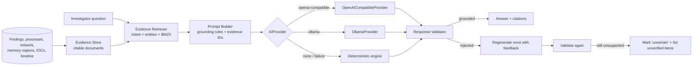

# AI Architecture - Grounded, Explainable Forensic Assistance

The AI never sees the memory image. It operates on **structured evidence** that Volatility and the
detection engine have already extracted, and every answer is checked against that evidence.



## 1. Evidence Store (`services/ai/evidence.py`)

Each stored artifact becomes a document with a stable ID:

| Prefix | Source | Example |
|---|---|---|
| `SUMMARY` | analysis summary, OS identification, plugin failures, rules not evaluated | always included |
| `PROC-<pid>` | process (path, cmdline, parent, risk score and contributors, modules) | `PROC-4528` |
| `F-<id>` | finding with evidence and confidence | `F-73` |
| `NET-<id>` | network endpoint | `NET-46` |
| `MEM-<id>` | memory region | `MEM-31` |
| `MOD-<id>` | suspicious module | `MOD-112` |
| `IOC-<id>` | indicator | `IOC-9` |
| `YARA-<id>` | YARA match | `YARA-1` |
| `TL-<id>` | non-trivial timeline event | `TL-88` |

## 2. Evidence Retriever (`retriever.py`) - retrieval, not "send everything"

1. **Intent classification** (regex): summary, most_suspicious, injection, parent_child, network, timeline,
   next_steps, ioc, credential, commandline, persistence, dll, simple.
2. **Entity extraction**: `PID n` and bare numbers that are real PIDs, process names, IPv4s, finding IDs.
   Requested PIDs that do not exist are recorded as *missing*.
3. **Structured look-ups**: for a PID → its process, parent, children, findings, connections, memory
   regions, IOCs; for an intent → the relevant document kinds ranked by importance.
4. **BM25 lexical ranking** fills remaining slots (default cap `AI_MAX_EVIDENCE_ITEMS=40`).

## 3. Prompt Builder (`prompts.py`)

The system prompt enforces: use only provided evidence; cite IDs in brackets after each claim; say exactly
**"Insufficient evidence in the analyzed memory image."** when evidence is missing; separate evidence from
interpretation; never claim something *is* malware; recommend only defensive steps; disclose demo data.

Finding explanations request strict JSON with keys `what_happened`, `why_suspicious`,
`possible_interpretation`, `does_not_prove`, `recommended_next_steps`. The **Evidence** and **Confidence**
sections are never generated - they are copied from the database.

## 4. Providers (`providers.py`)

```python
class AIProvider(ABC):
    def complete(self, messages: list[ChatMessageIn], *, json_mode: bool = False) -> str: ...

class OpenAICompatibleProvider(AIProvider):  # POST {base_url}/chat/completions
class OllamaProvider(AIProvider):            # POST {base_url}/api/chat
```

Configuration comes from environment variables, optionally overridden at runtime from the Settings page
(provider, base URL, model, temperature). **API keys are read from `AI_API_KEY` only** - never stored in
the database, returned by the API or logged. Any OpenAI-compatible endpoint works (OpenAI, vLLM, LM Studio,
llama.cpp server, OpenRouter, Groq, Azure gateways). Adding a provider = subclass + register in `PROVIDERS`.

## 5. Response Validator (`validator.py`)

| Check | Result if failed |
|---|---|
| Cited IDs exist in the evidence store | `rejected` |
| Every `PID n` mentioned is a PID in this analysis | `rejected` |
| Every IPv4, MD5/SHA-256 mentioned appears in the evidence | `rejected` |
| Every `*.exe` / `*.dll` mentioned appears in evidence or the detection knowledge base | `rejected` |
| Answer contains citations (unless it states insufficient evidence) | `uncertain` |
| Sentences asserting certainty ("is malware", "proves", "definitely") without negation | `uncertain` |

Policy: on `rejected` the assistant regenerates once with explicit feedback listing the unsupported items;
if the second answer is still rejected it is returned **marked uncertain** with the unverified items listed.
On any provider error the deterministic engine answers instead. The UI shows a "Grounded in evidence" or
"Validator: uncertain" badge on every answer.

## 6. Deterministic explanation engine (`deterministic.py`)

The offline engine composes answers from retrieved documents and per-rule explanation templates
(`DetectionRule.explanation`). It handles every supported question type:

* "Which processes are most suspicious?" → ranked processes with top score contributors
* "Why is PID 4528 suspicious?" → score, contributors, findings, parent, path, cmdline, network, memory,
  interpretation, limitations
* "What evidence suggests process injection?" → memory findings with regions
* "Show me suspicious parent-child relationships." / "What network connections belong to suspicious processes?"
* "Summarize the investigation." / "Generate an incident timeline." / "What additional evidence should an investigator examine?"
* "Explain this finding in simple language." → plain-language template + limitation

Because it only assembles stored facts, it cannot hallucinate - and its output still passes through the
validator (tests assert it is always grounded).

## 7. Explainable finding output

For every finding (generated on demand and cached in `ai_analysis`):

1. **What happened?** - plain language
2. **Why is it suspicious?** - evidence-based reasoning
3. **Evidence** - exact artifacts (plugin, field, value, reference) from the DB
4. **Confidence** - Low/Medium/High + numeric value + basis
5. **Possible interpretation**
6. **What it does NOT prove** - the forensic limitation
7. **Recommended next investigation** - defensive steps

## 8. Privacy

With an external API, evidence summaries (process names, paths, IPs, command lines) leave the server.
For sensitive cases use Ollama (local) or the deterministic engine. The memory image itself is never sent.
