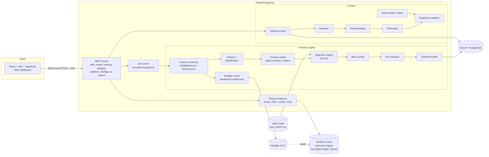
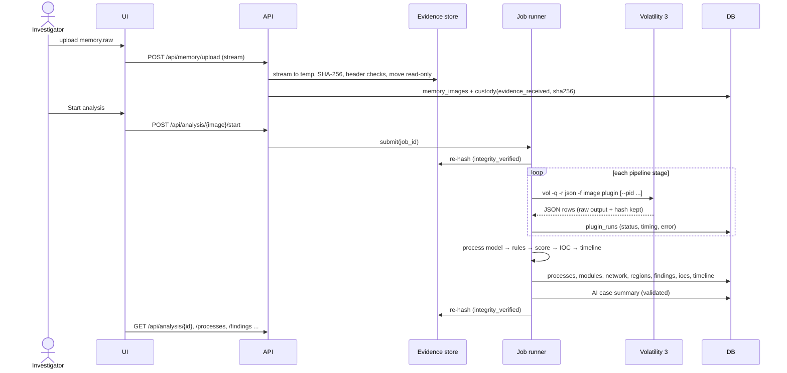
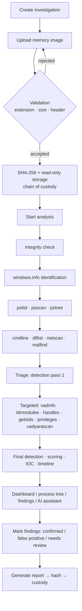

# System Architecture

MemTrace is a defensive digital-forensics platform. Its core is the **forensic engine**
(memory forensics → evidence extraction → detection → AI correlation). The web dashboard
is only the presentation layer.

## 1. System architecture



| Layer | Technology | Responsibility |
|---|---|---|
| Presentation | React 18, Vite, TypeScript, Tailwind CSS v4, Recharts | Dashboards, process tree, evidence tables, AI chat, reports |
| API | FastAPI, Pydantic v2 | Validation, authentication (JWT), routing, error handling |
| Engine | Python 3.11+, Volatility 3 | Plugin orchestration, parsing, detection, scoring, IOC, timeline |
| AI | provider abstraction (OpenAI-compatible, Ollama) + deterministic engine | Grounded explanations and Q&A |
| Persistence | SQLAlchemy 2.0, SQLite (dev) / PostgreSQL (prod) | Cases, evidence metadata, artifacts, findings, custody |
| Reporting | Jinja2 (HTML), ReportLab (PDF), csv/zip, JSON | Forensic reports with hashes |

## 2. Data flow



## 3. Investigation workflow



## 4. Key architectural decisions

| Decision | Rationale |
|---|---|
| **Run Volatility as a subprocess, not in-process** | Isolation: a crash or hang in a plugin parsing untrusted memory cannot take the API down; timeouts can kill it; raw JSON output is preserved for reproducibility; environment can be stripped of secrets. |
| **Staged pipeline with triage** | `handles`, `vadinfo`, `ldrmodules` system-wide are slow and produce enormous noisy output. Running them only for the top-N triaged PIDs keeps analysis time bounded while focusing evidence where it matters. |
| **Evidence-source abstraction** | `VolatilitySource` and `DemoSource` feed the same parsers, rules, scoring and AI layers. Demo mode therefore demonstrates the *real* engine, not mocked screens. |
| **Rules as Python classes + YAML knowledge** | Logic (code) is testable; baselines, patterns, ports, watchlists and scoring weights (YAML) are tunable by investigators without code changes. |
| **Thread pool instead of Celery** | A forensic workstation analyses a handful of images; a broker (Redis/RabbitMQ) adds operational cost without benefit. Volatility runs in child processes, so the GIL is irrelevant. The `JobRunner` interface can be swapped for Celery. |
| **Deterministic AI fallback** | The system must work offline and must never invent evidence. The deterministic engine is the reference behaviour; an LLM is optional and always validated. |
| **Evidence & confidence never come from the LLM** | In finding explanations the evidence list and confidence are copied from the database; the LLM only writes narrative. |
| **Hex strings for addresses** | 64-bit kernel addresses overflow signed 64-bit integer columns. |
| **ReportLab for PDF** | Pure Python; identical on Windows, Linux and Docker (no GTK/wkhtmltopdf). |

## 5. Security architecture (untrusted input)

| Control | Where |
|---|---|
| Extension allow-list, size limit (streamed), minimum size, header signatures (ZIP, PDF, PE, ELF, minidump, hibernation, LiME rejected) | `services/evidence/storage.py` |
| Client filename never used on disk; UUID name; read-only file mode | `storage.py` |
| Temp-file cleanup on any failure | `storage.py` |
| Plugin allow-list, only `--pid` (ints) and `--yara-file` (managed dirs) flags, no dump/output flags | `services/volatility/runner.py` |
| `shell=False`, per-plugin working dir, timeout + process-group kill, output-size cap | `runner.py` |
| Secrets stripped from the child environment | `runner.py` |
| YARA uploads: size limit, UTF-8, `include` rejected, compiled with yara-python when available | `services/yara/manager.py` |
| JWT auth on every endpoint, PBKDF2 password hashing, login lockout | `core/security.py`, `api/routes/auth.py` |
| Security headers (nosniff, frame deny, referrer), CSP in nginx | `main.py`, `frontend/nginx.conf` |
| Container: non-root UID, read-only root FS, `cap_drop: ALL`, `no-new-privileges`, memory & PID limits | `backend/Dockerfile`, `docker-compose.yml` |
| Secrets via environment only; redacted from structured logs | `core/config.py`, `core/logging.py` |
| Report/markdown rendering escapes all evidence text (no `innerHTML`) | `templates/report.html.j2`, `components/ui` |

## 6. Repository structure

```
backend/app/
  api/routes/        auth, cases, memory, analysis, evidence, findings, ai, reports, system
  core/              config, database, logging, security, exceptions
  models/            SQLAlchemy models (case.py, artifacts.py)
  schemas/           Pydantic request/response models
  services/
    evidence/        upload, hashing, validation, chain of custody
    volatility/      plugin catalogue, runner, parsers, identification
    analysis/        process model, evidence sources, pipeline, job runner
    detection/       rule framework, knowledge base, rules, cmdline analysis, engine
    scoring/         explainable risk model
    ioc/             patterns, extractor
    yara/            rule validation and bundling
    timeline/        timeline builder
    ai/              evidence store, retriever, prompts, providers, validator, deterministic engine, assistant
    reporting/       report data builder, HTML/PDF/JSON/CSV renderers
  templates/         report.html.j2
backend/tests/       unit + integration tests, fixtures
frontend/src/        pages, components, services, hooks, types
rules/               baselines, cmdline patterns, network heuristics, scoring, IOC watchlist
yara_rules/          built-in YARA rules
sample_data/         synthetic demo bundle (DEMO DATA)
scripts/             setup, dev runners, demo generator, schema export
docs/                this documentation
```
