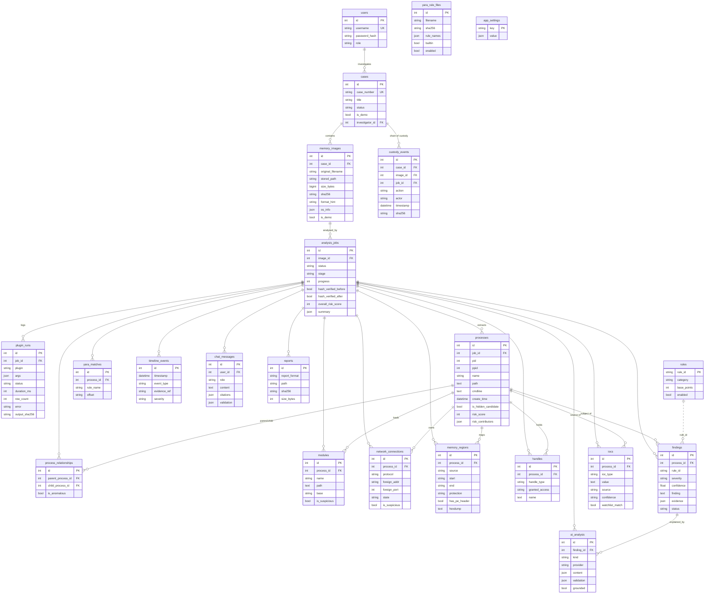

# Database Design

SQLAlchemy 2.0 models in `backend/app/models/`. SQLite (WAL mode) is used for development and PostgreSQL
for production (`DATABASE_URL=postgresql+psycopg://...`). The complete DDL generated from the models is in
[`schema.sql`](schema.sql) (`python scripts/export_schema.py postgresql > docs/schema.sql`).

## ER diagram

## Tables

| Table | Purpose |
|---|---|
| `users` | Investigators/administrators (PBKDF2-SHA256 hashes). |
| `cases` | Investigation container; `case_number` unique; demo cases flagged. |
| `memory_images` | Evidence metadata: original name, generated stored path, size, **SHA-256**, format, intake notes, OS identification. |
| `analysis_jobs` | One analysis run: status/stage/progress, integrity verification before/after, overall risk, JSON summary, Volatility version. Re-analysis creates a new job; artifacts never mix. |
| `plugin_runs` | Analysis log - every plugin execution with rationale, args, timing, status, error, raw-output SHA-256. |
| `custody_events` | Append-only chain of custody. |
| `processes` | Merged process model with source flags (pslist/psscan/pstree), hidden/terminated flags, SIDs, privileges, risk score and signed contributors. |
| `process_relationships` | Parent/child edges (PID-reuse aware) with anomaly flag - drives the process tree. |
| `modules` | dlllist entries enriched with ldrmodules flags and suspicion reasons. |
| `network_connections` | netscan endpoints, external flag and heuristic reasons. |
| `memory_regions` | malfind regions (all) and executable vadinfo regions for triaged processes; hexdump/disasm. |
| `handles` | Handles of triaged processes. |
| `yara_matches` | vadyarascan results with severity from rule metadata. |
| `findings` | Rule results with evidence JSON, confidence, points, ATT&CK IDs, investigator status. |
| `iocs` | Extracted indicators with provenance and confidence. |
| `rules` | Rule catalogue synced from code; enable/disable flag. |
| `timeline_events` | Timestamped (or explicitly undated) events with time source. |
| `ai_analysis` | Cached explanations and case summaries with provider and validation report. |
| `chat_messages` | Assistant conversation history with citations and validation. |
| `reports` | Generated reports with SHA-256 (also recorded in custody). |
| `yara_rule_files` | Built-in and uploaded YARA files. |
| `app_settings` | Runtime settings (AI provider; never API keys). |

## Indexes

| Index | Supports |
|---|---|
| `ix_process_job_pid (job_id, pid)` | process detail look-ups |
| `ix_process_job_risk (job_id, risk_score)` | ranked / suspicious-only lists |
| `ix_module_job_pid`, `ix_net_job_pid`, `ix_region_job_pid` | per-process detail tabs |
| `ix_finding_job_sev (job_id, severity)`, `ix_findings_rule_id`, `ix_findings_category` | findings filters |
| `ix_ioc_job_type (job_id, ioc_type)` | IOC explorer filters |
| `ix_timeline_events_timestamp` | timeline ordering |
| `ix_custody_case_time (case_id, timestamp)` | chain-of-custody view |
| `ix_memory_images_sha256` | locating evidence by hash |
| every `job_id` / `process_id` FK | joins and cascade deletes |

## Integrity and deletion semantics

* Deleting a case cascades to its images, jobs and all derived artifacts (`ON DELETE CASCADE`).
* User deletion sets references to NULL so custody records remain.
* Memory addresses are hex strings (64-bit kernel addresses overflow signed BIGINT).
* All timestamps are stored in UTC (`TIMESTAMP WITH TIME ZONE` on PostgreSQL).
* Schema migrations: tables are created with `create_all`; Alembic is listed as future work.
